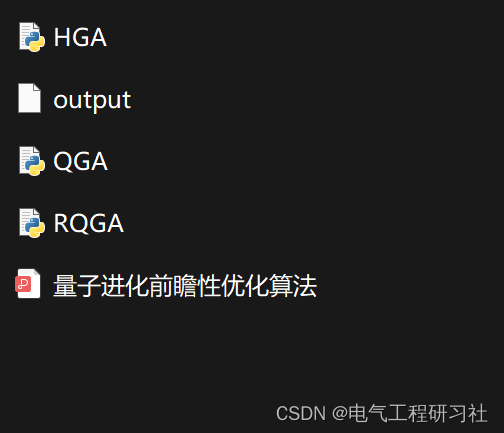

# Predictive Optimization Algorithm for Quantum Evolution (Python Code Implementation)

​  
This article outlines the following:
Evolutionary Computation (EC) represents a class of heuristic optimization techniques inspired by biological evolution, applicable to challenging real-world problems in engineering, science, and other fields. The EC paradigm includes Genetic Algorithms (GA), Evolution Strategies (ES), Evolutionary Programming (EP), Genetic Programming (GP), Particle Swarm Optimization (PSO), Cultural Algorithms (CA), and Distributed Estimation Algorithms (DEA). These search techniques are typically run on digital computers and can be described as searching for the most suitable members in the solution space among a population.
Evolutionary computation has been successfully applied to various problems, including robotic systems based on evolutionary behaviors, scheduling optimization problems (including the Traveling Salesman Problem (TSP)), circuit design (including quantum circuit design, which will be discussed later), and many control optimization tasks (just a few examples). Heuristic optimization techniques are usually most suitable for the following situations: (a) The space to be optimized does not conform to closed-form mathematical descriptions, thus allowing the use of more direct optimization techniques, (b) Constraints or nonlinearities in the solution space make it complex to use more direct optimization methods, (c) The size of the state space to be explored is exponential, excluding the use of exhaustive search, and (d) The exploration cost may be high. Any combination of these factors could suggest the use of heuristic EC techniques instead of more direct optimization methods such as line search, linear programming, Newton's method, or integer programming.2 Integrating Quantum and Evolutionary Computation Details can be found in Part 5.
3. See Section 5 for details inspired by quantum computing.
3.1 Quantum-inspired Genetic Algorithm (QIGA)
5. Matlab code and article detailed reading. This article only displays part of the code, all codes can be found in:
Editor
6. End Note: The references to theoretical literature are from online sources, and if any infringement is found, please contact the blogger for removal.
​  

## Images

<!-- PAYMENT_BLOCK -->

## Get this dataset

- Payment link (Stripe): [Buy now](https://buy.stripe.com/3cs8yP7sY87d0vu9AB)
- Payment QR code: 

<!-- /PAYMENT_BLOCK -->
